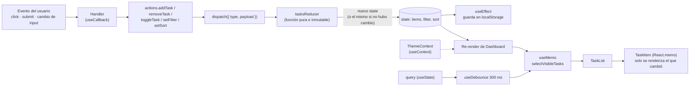
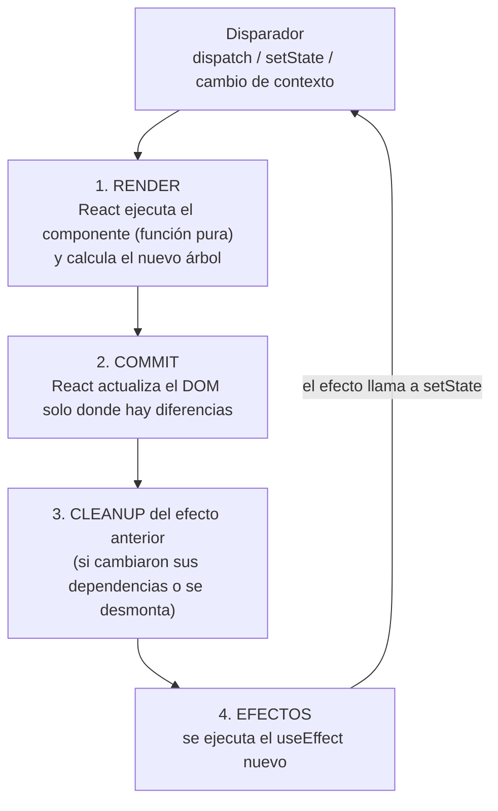

# Gestor de Tareas — Dashboard de Gestión con Estado Complejo

**Universidad Nacional del Centro del Perú · Facultad de Ingeniería de Sistemas**
**Asignatura:** Desarrollo de Aplicaciones Web (IS093A) · **Unidad I:** Desarrollo Web Frontend
**Práctica:** Guía Práctica Semana 07 – 2.ª parte (React Hooks)
**Alumno:** _______________________________

Dashboard de tareas hecho con **React 18 + Vite**, donde cada hook cumple un rol concreto y justificado:
`useReducer`, `useState`, `useContext`, `useEffect`, `useMemo`, `useCallback`, `useRef` y dos hooks personalizados (`useLocalStorage`, `useDebounce`).

## 1. Cómo ejecutarlo

```bash
npm install
npm run dev      # servidor de desarrollo (http://localhost:5173)
npm run lint     # ESLint con react-hooks/exhaustive-deps (debe terminar sin warnings)
npm run build    # build de producción
```

## 2. Estructura del proyecto

```
src/
├─ main.jsx                      # punto de entrada (StrictMode)
├─ App.jsx                       # Dashboard: conecta contexto, reducer, handlers y componentes
├─ index.css                     # estilos y tokens de tema claro/oscuro
├─ contexts/
│  └─ ThemeContext.jsx           # useContext + useEffect + useCallback + useMemo
├─ hooks/
│  ├─ useTasksReducer.js         # useReducer: reducer puro, acciones, persistencia
│  ├─ useLocalStorage.js         # HOOK PERSONALIZADO reutilizable
│  └─ useDebounce.js             # HOOK PERSONALIZADO reutilizable
├─ components/
│  ├─ TaskForm.jsx               # useRef (auto-focus) + useState local
│  ├─ Controls.jsx               # filtros / orden / búsqueda (React.memo)
│  ├─ TaskList.jsx               # useMemo + useCallback
│  ├─ TaskItem.jsx               # React.memo
│  ├─ SessionClock.jsx           # useEffect con cleanup (setInterval)
│  └─ ProfilerBoundary.jsx       # <Profiler> de React para medir commits
└─ utils/
   └─ taskUtils.js               # funciones puras: filtrar, buscar, ordenar
```

## 3. Diagrama de flujo de estado



Resumen del flujo: el usuario genera un evento → un handler estable crea una acción → `dispatch` la envía al reducer → el reducer devuelve un estado nuevo sin mutar el anterior → React re-renderiza `Dashboard` → `useMemo` recalcula la lista visible solo si cambió alguna de sus dependencias → solo los `TaskItem` cuyas props cambiaron se vuelven a renderizar → un `useEffect` guarda el estado en `localStorage`.

## 4. Ciclo de render



Puntos clave:

- **Render ≠ DOM**: renderizar es calcular qué mostrar; el commit es lo que toca el DOM.
- Los **efectos corren después del commit** y su **cleanup corre antes del siguiente efecto** y al desmontar.
- En desarrollo, **StrictMode** monta, desmonta y vuelve a montar cada componente para comprobar que los cleanups están bien; por eso en consola se ven los mensajes duplicados de `SessionClock`.
- `useRef` guarda valores/nodos que persisten entre renders **sin** provocar uno nuevo.

## 5. Justificación técnica de cada hook (¿por qué no un `useState` simple?)

| Hook | Dónde se usa | ¿Por qué este hook y no `useState`? |
|---|---|---|
| **`useReducer`** | `hooks/useTasksReducer.js` | La lista tiene varios sub-valores relacionados (`items`, `filter`, `sort`) y 6 acciones cuya lógica depende del estado anterior. Con `useState` habría varios setters dispersos, actualizaciones difíciles de seguir y riesgo de mutar el arreglo. El reducer centraliza las reglas en una función pura, testeable y con transiciones explícitas (`ADD`, `REMOVE`, `TOGGLE`, `FILTER`, `SORT`, `CLEAR_COMPLETED`). Si una acción no cambia nada devuelve el mismo `state` y React evita el re-render. |
| **`useState`** | `TaskForm` (título, prioridad, error), `Dashboard` (texto de búsqueda, mostrar reloj), `SessionClock` (segundos) | Es estado de **UI local**, de un solo valor y sin lógica compleja. Subirlo al reducer sería sobre-ingeniería y ensuciaría el estado de dominio. |
| **`useContext`** | `ThemeContext` | El tema lo necesitan varios componentes y evita pasar `theme` por props (prop drilling). Es un dato que cambia **muy poco**, justo el caso para el que sirve el contexto. No se usó para la lista de tareas porque cambia con frecuencia y re-renderizaría a todos los consumidores. |
| **`useEffect`** | `ThemeContext` (clase en `<body>`), `useLocalStorage` (persistir y escuchar `storage`), `useTasksReducer` (persistir), `Dashboard` (atajo `/`), `SessionClock` (intervalo), `TaskForm` (foco inicial), `useDebounce` (temporizador) | Son **efectos secundarios** (tocar el DOM del `<body>`, `localStorage`, listeners, timers). No pueden hacerse durante el render porque este debe ser puro. Cada efecto que abre algo lo cierra en su **cleanup** (`removeEventListener`, `clearInterval`, `clearTimeout`, `classList.remove`). |
| **`useMemo`** | `TaskList` (`processedTasks`), `Dashboard` (`stats`), `ThemeContext` (value), `useTasksReducer` (`actions`) | Filtrar + buscar + ordenar es trabajo que crece con el tamaño de la lista; se recalcula solo si cambian `tasks`, `filter`, `sort` o `query`. En el contexto y en `actions` se usa para mantener **la misma referencia** y no invalidar `memo` ni re-renderizar consumidores. |
| **`useCallback`** | Handlers de `TaskList`, `TaskForm`, `Dashboard`, `toggleTheme` | Las funciones se recrean en cada render; si se pasan a hijos con `React.memo` (`TaskItem`, `Controls`, `TaskForm`) rompen la memoización. `useCallback` conserva la referencia mientras no cambien sus dependencias. Solo se aplicó donde hay un hijo memoizado que lo aprovecha (sin *overuse*). |
| **`useRef`** | `TaskForm` (input), `Dashboard` (input de búsqueda) | Permite hacer `focus()` sobre un nodo DOM **sin re-render** y sin estado. Un `useState` para guardar el nodo causaría renders innecesarios. |
| **`useLocalStorage`** (custom) | Tema | Encapsula leer/escribir/sincronizar `localStorage` con la misma API que `useState`. Es reutilizable para cualquier clave y evita repetir el patrón `useState` + `useEffect` en cada componente. |
| **`useDebounce`** (custom) | Búsqueda | El texto del input se actualiza al instante (la escritura se siente fluida), pero la lista solo se filtra 300 ms después de la última tecla. |
| **`React.memo`** | `TaskItem`, `Controls`, `TaskForm` | Evita re-renderizar hijos cuando sus props no cambiaron. Funciona porque las props son estables (tareas inmutables + `useCallback`). |
| **`<Profiler>`** | `ProfilerBoundary` | Registra en consola cada commit de `TaskList` (fase, duración) para respaldar con datos las optimizaciones. |

### Decisiones de diseño

- **Pureza del reducer**: `id` y `createdAt` se generan en el creador de la acción, no dentro del reducer.
- **Inmutabilidad**: siempre se devuelven objetos y arreglos nuevos (`map`, `filter`, spread); nunca `push`, `splice` ni asignaciones sobre el estado.
- **Valores derivados no se guardan en estado**: `stats` y la lista visible se calculan desde `state`, así no pueden desincronizarse.
- **Refactor del código base**: el `<input>` de "Nueva tarea" se movió de `TaskList` a `TaskForm`, con su propio `useRef`. Así la lista solo muestra datos y el formulario maneja su foco.
- **Dependencias completas**: ningún `useEffect`/`useMemo`/`useCallback` oculta dependencias con comentarios `eslint-disable`.

## 6. Mapa de la rúbrica

| Criterio (20 % c/u) | Dónde se cumple |
|---|---|
| `useReducer` + estado complejo | `src/hooks/useTasksReducer.js` |
| `useContext` + `useEffect` (sync, cleanup, dependencias) | `src/contexts/ThemeContext.jsx`, `SessionClock.jsx`, atajo `/` en `App.jsx` |
| `useMemo` / `useCallback` sin overuse | `TaskList.jsx`, `App.jsx`, `TaskItem.jsx` (memo) |
| `useRef` + hook personalizado funcional y reutilizable | `TaskForm.jsx`, `useLocalStorage.js`, `useDebounce.js` |
| Validación Profiler/ESLint + documentación | Este README y `docs/VALIDACION.md` |

## 7. Validación final (Entregable 2)

El paso a paso y la plantilla de evidencias están en **[`docs/VALIDACION.md`](docs/VALIDACION.md)**. Las capturas van en `docs/capturas/`.

## 8. Reglas de Hooks aplicadas

1. Los hooks se llaman solo en el nivel superior del componente o del hook personalizado: nunca dentro de `if`, bucles ni funciones anidadas. (Los `return` anticipados de `TaskList` están **después** de todos los hooks.)
2. Solo se llaman desde componentes funcionales o desde hooks personalizados (`use...`).
3. Todo efecto con listeners, timers o clases del DOM tiene cleanup.
